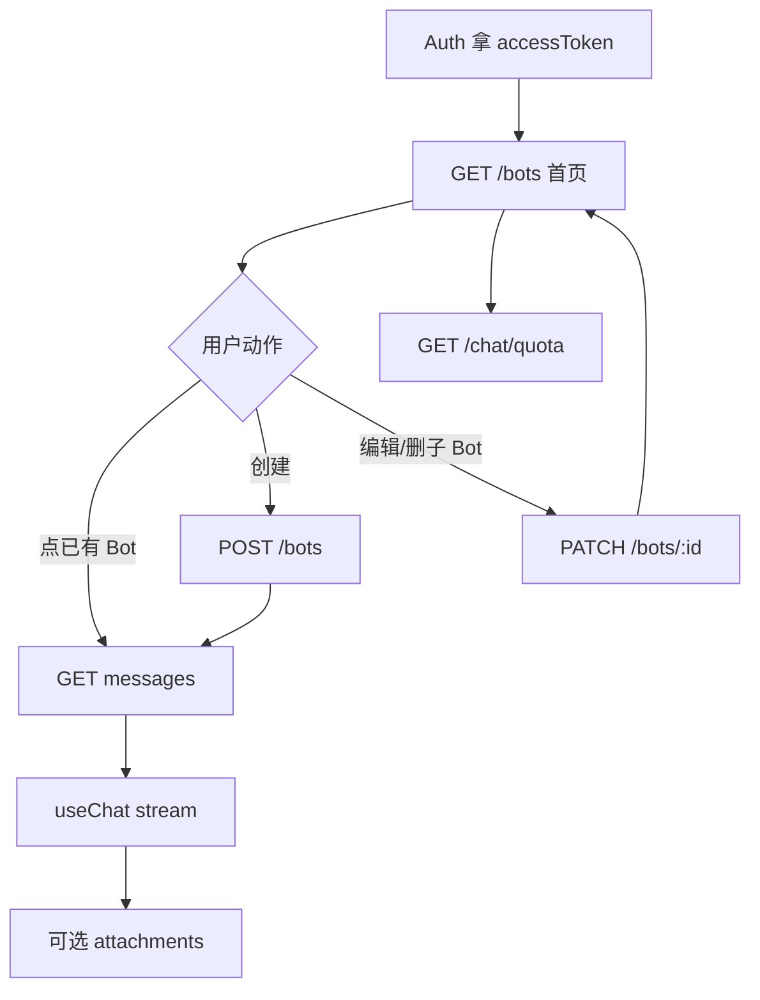

# 前端 AI 对接交接（demo-frontend）

> **受众：** `rn-ai-chat-demo-frontend`（或同名 demo 前端）在 **AI 功能分支**上的 Cursor / 开发者  
> **后端状态：** Bot + Chat 已合入 `develop`（PR #11）  
> **契约正文：** 同仓库 [`docs/chat-api-frontend.md`](./chat-api-frontend.md)（字段级 API）  
> **设计规格：** [`docs/superpowers/specs/2026-10-13-bots-design.md`](./superpowers/specs/2026-10-13-bots-design.md)

本文是给前端开干用的 **产品流程 + 对接约束 + Superpowers 启动说明**。实现细节以 `chat-api-frontend.md` 为准；冲突时以后端 `develop` 行为与该契约为准。

---

## 0. 给前端 Agent 的开场指令（复制即用）

在 **demo-frontend** 仓库新建分支（建议 `feature/ai-bots` 或 `feature/ai`），新开 Cursor 对话，粘贴：

```text
请用 superpowers 流程对接后端 AI/Bot（后端 develop 已合并）。

必读（可从后端仓库拉取或我粘贴）：
1. docs/frontend-ai-handoff.md（本交接：流程与约束）
2. docs/chat-api-frontend.md（HTTP 契约）

硬性约束：
- 首页/列表/创建入口以 Bot 为中心，禁止再调 POST /chat/conversations
- conversationId 一律来自 Bot DTO（GET/POST /bots）
- UI 展示名用 Bot.name，不用 Conversation.title 当主展示
- 流式用 @ai-sdk/react useChat + DefaultChatTransport（RN 用 expo/fetch）
- 先 brainstorming → 写 spec → writing-plans → 再实现；未批准设计前不要写业务代码

当前前端若仍有 mock bots / create-bot 本地状态，请在 brainstorm 里对照本交接列出「mock → API」替换表。
先探索仓库现状，再按 brainstorming 一次只问一个澄清问题。
```

---

## 1. 用 Superpowers 怎么开干

按顺序，**不要跳过 brainstorm**：

| 步  | Skill                                              | 产出                                                           |
| --- | -------------------------------------------------- | -------------------------------------------------------------- |
| 1   | `brainstorming`                                    | 弄清：哪些屏已 mock、要接真 API 的范围、与 Auth/额度的依赖     |
| 2   | 用户批准设计后写 spec                              | `docs/superpowers/specs/YYYY-MM-DD-ai-bots-frontend-design.md` |
| 3   | `writing-plans`                                    | `docs/superpowers/plans/YYYY-MM-DD-ai-bots-frontend.md`        |
| 4   | `subagent-driven-development` 或 `executing-plans` | 按 Task 实现 + 测                                              |
| 5   | `finishing-a-development-branch`                   | PR 进前端主开发分支                                            |

建议分支：`feature/ai` / `feature/ai-bots`，与后端同批发布窗口对齐（见 §6）。

**本轮前端建议范围（可在 brainstorm 裁剪）：**

- 首页：`GET /bots` 列表 + 预览字段
- 创建页：`POST /bots`（替代 mock / 旧创建会话）
- 聊天：历史 + stream（`conversationId` 来自 Bot）
- 改名/外观/人设：`PATCH /bots/:id`
- 删子 Bot：`PATCH` + `deleted: true`
- 额度条：`GET /chat/quota`
- （可选）图片：`POST /chat/attachments` + stream `attachmentIds`

**明确非目标（除非产品另开）：** 主 Bot 感知子 Bot 记忆、Bot 头像 URL、群聊、假 LLM e2e。

---

## 2. 领域模型（前端心智）

```text
User
 └─ Bot (main | sub)  ──1:1──  Conversation
                              └─ Message*
                              └─ Attachment*（可挂消息）
```

| 概念                     | 说明                                                                                                |
| ------------------------ | --------------------------------------------------------------------------------------------------- |
| **主 Bot (`kind=main`)** | 注册时后端已建好；不可软删；默认外观黑圆 `#0A0A0A` / `circle`；名多为 `APP_NAME` 快照（常「牛马」） |
| **子 Bot (`kind=sub`)**  | 仅 `POST /bots`；创建时附带唯一会话                                                                 |
| **conversationId**       | 聊天/历史/stream 的路径参数；**始终从 Bot 拿**，不要前端自己「先建会话」                            |
| **展示名**               | 只用 `Bot.name`                                                                                     |

懒补：老用户若缺主 Bot，`GET /bots` 会服务端补建，前端无需特殊处理。

---

## 3. 全流程（按用户旅程）

### 3.1 注册 / 登录 → 进入 App

```text
POST /auth/register 或 /auth/login
  → data.accessToken
  →（register）服务端已创建 main Bot + Conversation
  → 前端存 token，后续请求带 Authorization: Bearer …
```

前端动作：登录成功后进首页，**直接** `GET /bots`，不要再「创建默认会话」。

### 3.2 首页（Bot 列表）

```text
GET /bots
  → data: BotDto[]
     main 在前，其余按 updatedAt 降序
     每项含 lastMessagePreview / lastMessageAt / conversationId
```

UI：

- 列表项标题 → `name`
- 副文案 → `lastMessagePreview`（可空）
- 时间 → `lastMessageAt`
- 头像 → `faceColor` + `faceShape`
- 点击 → 进聊天，携带 `bot.id` + `conversationId`（或只带 botId 再 `GET /bots/:id`）

### 3.3 创建子 Bot

```text
创建页表单 → POST /bots
  body: { name, faceColor, faceShape, systemPrompt? }
  → 201 + BotDto（已含 conversationId）
  → 跳转聊天页用该 conversationId
```

校验提示：`faceColor` 必须 `#` + 6 位 hex；`name` 1–50。

### 3.4 进入聊天 · 拉历史

```text
GET /chat/conversations/:conversationId/messages?limit=50
  → { items, hasMore }
  → items 时间升序；图片 parts 带临时 url
```

注意：历史接口**不返回** `reasoningContent`；思考只在流式 UI Message 里出现。

### 3.5 流式发消息（核心）

```text
POST /chat/conversations/:conversationId/messages/stream
  Content-Type: application/json
  响应: text/event-stream（AI SDK UI Message Stream）
  → 用 useChat + DefaultChatTransport，勿当 JSON 信封解析
```

人设：

- Bot 有非空 `systemPrompt` → 只用 Bot 人设（覆盖全局）
- 否则 → 后端全局 `CHAT_SYSTEM_PROMPT`（若配置）

额度：流前检查失败 → **429**；可先 `GET /chat/quota` 展示。

### 3.6 带图对话（可选）

```text
POST /chat/attachments  (multipart, 字段名 file)
  → { id, mimeType, byteSize }
  → stream 时带 attachmentIds: [id, …]
```

`CHAT_ATTACHMENT_STORAGE=disabled` → **503**，前端应隐藏上传。

### 3.7 改 Bot / 删子 Bot

```text
PATCH /bots/:id
  { name?, faceColor?, faceShape?, systemPrompt?, deleted?: true }
```

- 改展示名 / 外观 / 人设：走这里
- `deleted: true`：仅 **sub**；main → **400**「主 Bot 不可删除」
- 删子 Bot 后会话一并软删，首页刷新不再出现

### 3.8 额度

```text
GET /chat/quota → usedPercent / remainingPercent / resetsAt / …
```

建议在首页或聊天顶栏展示；429 时提示看 `resetsAt`。

---

## 4. 流程简图



---

## 5. 从 Mock 迁到真 API（前端对照）

| 旧做法（典型 mock）          | 新做法                                  |
| ---------------------------- | --------------------------------------- |
| 本地 `bots[]` / AsyncStorage | `GET /bots`                             |
| 创建页只写本地               | `POST /bots`，用返回的 `conversationId` |
| `POST /chat/conversations`   | **删除调用**；会话随 Bot 创建           |
| 会话 title 当昵称            | `Bot.name` + `PATCH /bots/:id`          |
| 聊天用自造 conversationId    | 只用 Bot 下发的 UUID                    |
| 自研 SSE 解析                | AI SDK `DefaultChatTransport`           |

---

## 6. 发布与联调注意

1. **与后端同批上线**：旧客户端若仍打 `POST /chat/conversations` → **404**（难区分「路由没了」与「资源不存在」）。
2. Base URL：开发机局域网或测试域名；RN 注意明文 HTTP / 证书。
3. 鉴权：Chat / Bot / 附件均需 Bearer；401 → 清 token 回登录。
4. 限流：stream ≈ **10/min**；创建 Bot ≈ **20/min**；列表 ≈ **60/min**。
5. 统一信封：`code` / `message` / `data`；**仅 stream 例外**。

---

## 7. 联调检查清单（前端合入前）

- [ ] 注册后首页能看到 `kind=main` 的 Bot
- [ ] 创建子 Bot → 立刻能用返回的 `conversationId` 聊天
- [ ] 无任何 `POST /chat/conversations` 调用（搜仓库确认）
- [ ] 首页预览来自 `lastMessagePreview` / `lastMessageAt`
- [ ] 改名走 `PATCH /bots/:id`，界面读 `Bot.name`
- [ ] 删子 Bot 成功；删主 Bot 展示服务端中文错误
- [ ] stream：思考/文本正常；断线不白屏
- [ ] 额度条可用；额度尽时 429 有提示
- [ ] （若做图）上传失败 503 时入口隐藏或降级

---

## 8. 后端仓库定位

| 项      | 值                                                       |
| ------- | -------------------------------------------------------- |
| 仓库    | `qibmz/rn-ai-chat-demo-backend`                          |
| 分支    | `develop`（已含 Bot）                                    |
| 契约    | `docs/chat-api-frontend.md`                              |
| 本交接  | `docs/frontend-ai-handoff.md`                            |
| 合并 PR | https://github.com/qibmz/rn-ai-chat-demo-backend/pull/11 |

建议前端把上述两份 md **拷贝或 submodule/链到** 本仓库 `docs/`，再开 Superpowers，避免 Agent 找不到契约。

---

## 9. 开放给 Brainstorm 的问题（一次一个）

前端 Agent 可按优先级问产品/开发者：

1. 本轮是否必须接图片附件，还是纯文本先上？
2. 创建 Bot 页是否保留「群聊/定时」等筛选项（后端本轮无对应字段）？
3. 首页是否仍保留「会话列表」入口，还是完全 Bot 列表？
4. `systemPrompt` 编辑入口放在创建页、设置页还是聊天内？
5. 与现有 Auth / 环境变量（API Base）是否已打通，只需换 Chat 数据层？
